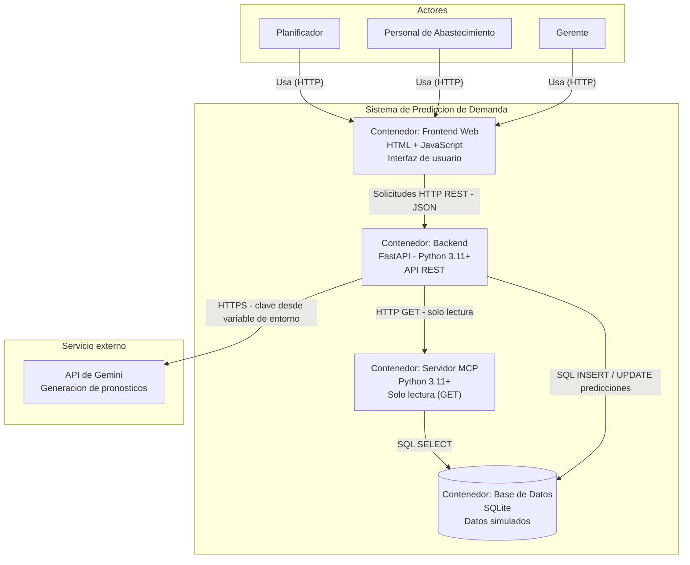
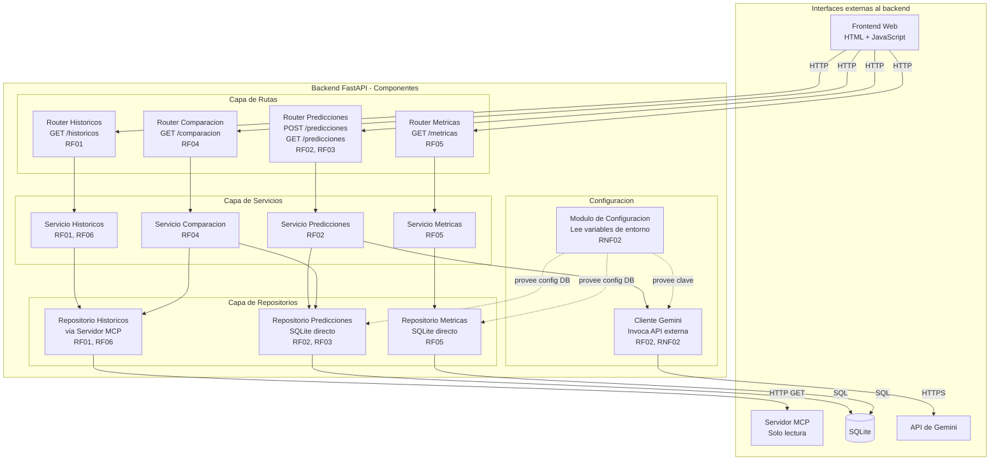
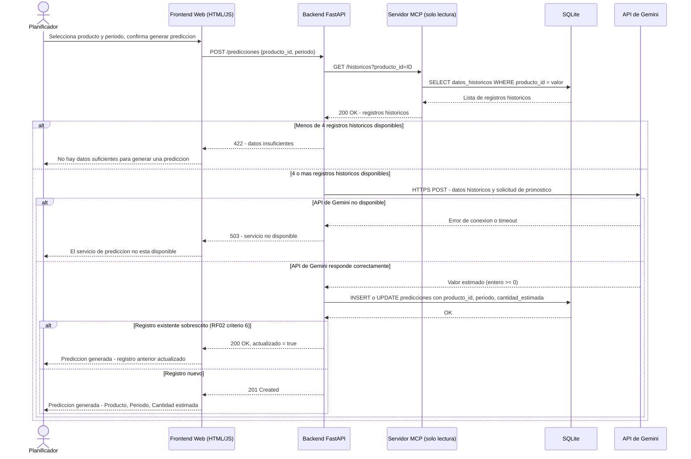

# Documento de Diseño — Predicción de Demanda de Productos Frescos y Ultrafrescos

**Versión:** 1.1  
**Estado:** Borrador  
**Fecha:** 2026-10-02  
**Fuentes:** `requirements.md`, `.kiro/steering/tech.md`, `docs/ADR/ADR-001.md`

---

## 1. Visión General

El sistema es un prototipo web de dos capas: un frontend HTML/JavaScript que el usuario abre en el navegador, y un backend FastAPI (Python 3.11+) que expone una API REST. Los datos históricos simulados y las predicciones generadas residen en SQLite. El backend consulta los datos históricos exclusivamente a través del Servidor MCP, que opera en modo solo lectura; las predicciones se escriben directamente en SQLite. Para generar pronósticos el backend invoca la API de Gemini, cuya clave se lee desde una variable de entorno y nunca se almacena en el código ni en el repositorio. El agente conversacional queda diferido; se documenta únicamente el punto de extensión donde se conectará en una unidad posterior.

---

## 2. Diagrama C4 — Nivel 2: Contenedores

---

## 3. Diagrama C4 — Nivel 3: Componentes del Backend FastAPI

---

## 4. Diagrama de Secuencia — Generar Predicción de Demanda (RF02)

---

## 5. Tabla de Componentes

| Componente | Responsabilidad (una línea) | Historias / Requisitos que satisface |
|---|---|---|
| **Frontend Web** | Interfaz HTML/JS que permite al usuario interactuar con todas las funcionalidades del sistema | RF01, RF02, RF03, RF04, RF05 |
| **Router Históricos** | Expone `GET /historicos` y delega la lógica al Servicio Históricos | RF01 |
| **Router Predicciones** | Expone `POST /predicciones` y `GET /predicciones`; delega al Servicio Predicciones | RF02, RF03 |
| **Router Comparación** | Expone `GET /comparacion` y delega al Servicio Comparación | RF04 |
| **Router Métricas** | Expone `GET /metricas` y delega al Servicio Métricas | RF05 |
| **Servicio Históricos** | Orquesta la consulta de datos históricos a través del Repositorio Históricos | RF01, RF06 |
| **Servicio Predicciones** | Valida disponibilidad mínima de datos, invoca el Cliente Gemini y persiste el resultado | RF02 |
| **Servicio Comparación** | Combina predicción y dato real del mismo producto y periodo, y calcula la diferencia absoluta | RF04 |
| **Servicio Métricas** | Calcula MAE y MAPE sobre los pares comparables, excluye ceros del MAPE con notificación | RF05 |
| **Repositorio Históricos** | Realiza las llamadas `HTTP GET` al Servidor MCP y mapea la respuesta a objetos de dominio | RF01, RF06 |
| **Repositorio Predicciones** | Ejecuta `INSERT`/`UPDATE` de predicciones en SQLite directamente | RF02, RF03 |
| **Repositorio Métricas** | Ejecuta consultas `SELECT` sobre predicciones y datos históricos para el cálculo de métricas | RF05 |
| **Módulo de Configuración** | Carga variables de entorno al inicio; rechaza el arranque si `GEMINI_API_KEY` no está definida o está vacía | RNF02 |
| **Cliente Gemini** | Encapsula la llamada HTTPS a la API de Gemini leyendo la clave desde el Módulo de Configuración | RF02, RNF02 |
| **Servidor MCP** | Servidor independiente que acepta solo operaciones de lectura y rechaza escrituras con HTTP 405 | RF06 |
| **SQLite (datos simulados)** | Almacena datos históricos simulados y predicciones generadas; sin datos personales reales | RF01, RF02, RF03, RF04, RF05, RF06 |

---

## 6. Punto de Extensión para una Unidad Posterior

En una unidad posterior se incorporará un agente conversacional que permitirá consultar el sistema en lenguaje natural. Para no afectar el diseño actual se reserva un único punto de conexión:

**Dónde:** `app/integrations/` — se agregará un módulo dedicado al agente que consumirá el Servidor MCP existente para las consultas de solo lectura.

**Lo que ya está listo para esa conexión:**

- El **Servidor MCP** ya opera en modo solo lectura y expone todos los datos que el agente necesitaría consultar, sin requerir cambios en su contrato de interfaz.
- La carpeta `app/integrations/` y sus convenciones están definidas desde esta unidad; el módulo del agente se agregará ahí sin alterar los módulos actuales.
- El archivo `.env` ya acepta variables de entorno adicionales; la clave del agente se registrará como una variable nueva sin modificar las existentes.

**Lo que NO se diseña aquí:** el agente conversacional, el modelo de lenguaje que lo impulse, la interfaz de chat, el protocolo de comunicación agente–MCP ni ninguna lógica de razonamiento o planificación. Todo ello queda para la unidad correspondiente.

> Conforme a `tech.md`: el agente se difiere para una unidad posterior; esta semana únicamente se documenta el punto de extensión.

---

## 7. Decisiones Tomadas y Pendientes

### Decisiones resueltas durante la implementación

**D1 — Esquema de base de datos** ✅ RESUELTA  
Tablas: `categoria_producto`, `producto`, `dato_historico`, `prediccion`. Tipos SQLite: `INTEGER PRIMARY KEY AUTOINCREMENT`, `TEXT NOT NULL`, `INTEGER NOT NULL CHECK (… >= 0)`. Índices sobre `id_producto` y `periodo` en ambas tablas de datos. Archivo: `database/schema.sql`.

**D3 — Formato de almacenamiento del periodo** ✅ RESUELTA  
El periodo se almacena como cadena de texto `AAAA-WNN` (ejemplo: `2024-W01`) en las columnas `periodo` de `dato_historico` y `prediccion`. Esta representación permite ordenamiento lexicográfico correcto como valor ordinal sin conversión adicional. Las consultas de comparación y métricas usan `ORDER BY periodo ASC` directamente. Verificado en `database/prediccion_demanda.db`: 70 registros con formato `AAAA-WNN`.

**D5 — Contenido del prompt a Gemini** ✅ RESUELTA  
El prompt incluye: nombre del producto, lista de periodos con su demanda real en formato `AAAA-WNN: N unidades`, y la instrucción de responder únicamente con un entero no negativo. Archivo: `app/integrations/gemini_client.py`, función `generar_pronostico()`.

**D7 — Variables de entorno** ✅ RESUELTA  
Variables requeridas: `GEMINI_API_KEY` (obligatoria, el backend no arranca si está ausente o vacía), `DATABASE_PATH` (por defecto `database/prediccion_demanda.db`), `MCP_BASE_URL` (por defecto `http://localhost:8001`). Plantilla en `.env.example`. Archivo de carga: `app/config/settings.py`.

### Decisiones aún pendientes

2. **Contrato de la API REST (esquemas JSON):** estructura completa de los cuerpos de solicitud y respuesta de cada endpoint (campos, tipos, validaciones Pydantic). Se especificarán durante la implementación.

4. **Configuración de red del Servidor MCP:** puerto definitivo fijado en 8001 por convención; política formal de reintentos desde el backend hacia el MCP aún no documentada como ADR.

6. **Política de concurrencia en escrituras:** comportamiento ante solicitudes simultáneas de generación de predicción para el mismo producto y periodo. SQLite serializa escrituras por defecto; no se ha definido política explícita de manejo de errores de bloqueo.

8. **Framework y estructura de pruebas automatizadas:** selección del framework (por ejemplo pytest) y organización de los casos de prueba para las propiedades definidas en `requirements.md`.

---

*Fuentes consultadas: `requirements.md`, `.kiro/steering/tech.md`, `docs/ADR/ADR-001.md`. Tecnologías usadas exclusivamente según esas fuentes: Python 3.11+, FastAPI, SQLite, HTML/JavaScript, API de Gemini, Servidor MCP.*
